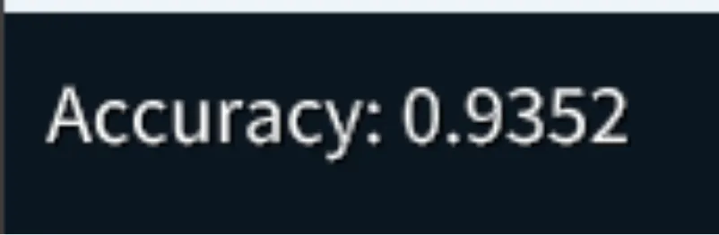

# 学習済みのデータを読み込んでMNISTを推論してみる  
前回[^1],MNISTを読み込むことを終えた.  
次はDeepLearningの学習...の前に実際に重みを読み込んで実行してみよう.  

今回作るのは3層のニューラルネットワーク.  
細かいことを除けば、計算としては以下の計算を三回やるだけである.  

```math
p_{i+1} = w_{i} * p_{i} + b_{i}
```
$`w_{i}`$が重みで$`b_{i}`$がバイアス.  
この重みとバイアスが学習するごとに最適な値になっていくことになる.  
今回は学習後なので、この最適に計算した値が手に入ることになる.  

ということでまずはデータを読み込んでいこう.  
初期化は今回はこんな感じにしてみた.  
```c++
	bool NeuralMNIST::Initialize()
	{
		if (!m_mnist.Initialize()) { return false; }

		if (!LoadWeight()) { return false; }

		return true;
	}
```
`m_mnist`は前回のMNISTの読み込みをしてくれる.  
重要なのは`LoadWeight`だ.  
今回のWeightはPythonのデータになっており、pickleというpythonのライブラリで作られていて使いづらい...  
そのため、まずpython側でjsonに変換をした.  
内容は以下のような感じ、力技～.  
```c++
import pickle
import json
import numpy as np

with open("sample_weight.pkl", 'rb') as f:
    network = pickle.load(f)
    with open("sample_weight.json", 'w') as w:
        network['b1'] = network['b1'].tolist()
        network['b2'] = network['b2'].tolist()
        network['b3'] = network['b3'].tolist()
        network['W1'] = network['W1'].tolist()
        network['W2'] = network['W2'].tolist()
        network['W3'] = network['W3'].tolist()
        json.dump(network, w)
```
こうして変換jsonを`LoadWeight`では読み込む.  
jsonであればSiv3Dでは機能があるため楽に行ける.  
```c++
	bool NeuralMNIST::LoadWeight()
	{
		m_weightPath = FileSystem::CurrentDirectory() + U"Resource/Ex03/sample_weight.json";

		const auto json = JSON::Load(m_weightPath);
		if (!json)
		{
			Logger << U"Json File Load Failed: " << m_weightPath;
			return false;
		}
```
ここまで来れば簡単だ.  
まずバイアスをデータとして読み込む.  
```c++
		// bias
		const Array<String> biasNameList = { U"b1", U"b2", U"b3" };
		for (const auto& biasName : biasNameList)
		{
			nc::NdArray<float> bs;
			const auto data = json[biasName];
			bs.resizeFast(1, data.size());
			for (int i = 0; const auto& bias : json[biasName])
			{
				bs[i] = (bias.value.get<float>());
				i++;
			}
			m_weightMap[biasName] = bs;
		}
```
そして、重みも読み込む.  
```c++
		// weight
		const Array<String> weightNameList = { U"W1", U"W2", U"W3" };
		for (const auto& weightName : weightNameList)
		{
			nc::NdArray<float> ws;
			const auto data = json[weightName];
			ws.resizeFast(data.size(), data[0].size());
			for (int i = 0; const auto& weightKey : data)
			{
				for (int j = 0; const auto& weight : weightKey.value)
				{
					ws[j + i * ws.numCols()] = weight.value.get<float>();
					j++;
				}
				i++;
			}
			m_weightMap[weightName] = ws;
		}

		return true;
	}
```

重みもバイアスもまとめて一緒に`m_weightMap`に突っ込んだ.  
あまりにも適当だけど、まあ今回はそこまで深く考えなくてもいいでしょう.  

さて、計算は単純.  
まずデータを持ち出して計算用の関数も用意.  
テストした結果ちゃんと判定できていたものは、`count`に足すことでカウントすることにする.  
```c++
	void NeuralMNIST::Process()
	{
		ClearPrint();

		const auto& testImages = m_mnist.GetTestImages();
		const auto& testLabels = m_mnist.GetTestLabels();

		FuncSigmoid sigmoid;
		FuncSoftmax softmax;

		int count = 0;
```
さて、実際の計算.  
3層の計算は簡単に`weight`と`bias`で計算するだけ.  
損失関数はsigmoidを使用.  
これは以前にやったね.  
そしてソフトマックスを計算して、最大値のものを取得すればそれが答えのラベルとなる.  
```c++
		for (int i = 0; i < testImages.numRows(); i++)
		{
			auto data = testImages.row(i);
			data /= 255.0f;

			data = data.dot(m_weightMap[U"W1"]) + m_weightMap[U"b1"];
			sigmoid.Process(data);
			data = data.dot(m_weightMap[U"W2"]) + m_weightMap[U"b2"];
			sigmoid.Process(data);
			data = data.dot(m_weightMap[U"W3"]) + m_weightMap[U"b3"];
			softmax.Process(data);

			auto maxIndex = data.argmax()[0];
			auto label = testLabels[i];
			if (label == maxIndex)
			{
				count++;
			}
		}
```

さて、ソフトマックスはやってない気がする.  
自分が触れたことがるのでいえば、強化学習[^2]での学習時にちょっとやったのでこっちに解説は譲る.  
要は全部足したら1になるように正規化するように全部の和で割る.  
割っただけで値の比率は同じなので、すべての値の内一番大きい奴が欲しかったものになる.  
という風な感じ.  
```c++
	void Process(nc::NdArray<float>& results) const override
	{
		const auto maxValue = results.max();
		results = results - maxValue;

		// 合計を計算
		auto temp = results; 
		for (auto& value : temp) { value = Exp(value); }
		auto sum = temp.sum();

		// softmaxを適用
		for (auto& value : results)
		{
			value = Exp(value) / sum[0];
		}
	}
```
今回は上のような感じで計算した.  
ちょっと変わってるのが`results-maxValue`としてる点.  
計算した値が非常に大きい場合,sotgmaxだと`Exp`をするためオーバーフローしやすい.  
そのため、オーバーフローしないように値を調整してるだけである.  
強化学習の時はまずそんな飽和することがなかったためやってなかったけど、こういうのはやっといた方がエラーが少なくて良いですね.  

さて、最後に結果を出力.  
正確性は割合で正解と判定された数と実際のデータ数で割ってあげればよい.  
こうすれば最大$`1.0=100\%`$という風になるわけだ.  
```c++
		Print << U"Accuracy: " << Format(static_cast<float>(count) / testImages.numRows());
	}
```

さて、学習した結果以下のものが出力される.  



うん、この結果はちゃんとpython側で実装されているものと同じ.  
ということはちゃんと結果があってると言える.  
つまり、93.52%の確率で正解しているというようなモデルが生成されてるわけだ.  

こんな風にとりあえず今回は重みを読み込んで、実際に計算をしてみたものとなる.  
ただ、Batchされておらずちょっと使いにくいため、次はBatchを行っていくことにする.  

[^1]: [MNISTを試しに描画する](./DrawMNIST.md)
[^2]: [GradientBaseline](./../../RL/Sutton/Ex02/GradientBaseline.md)