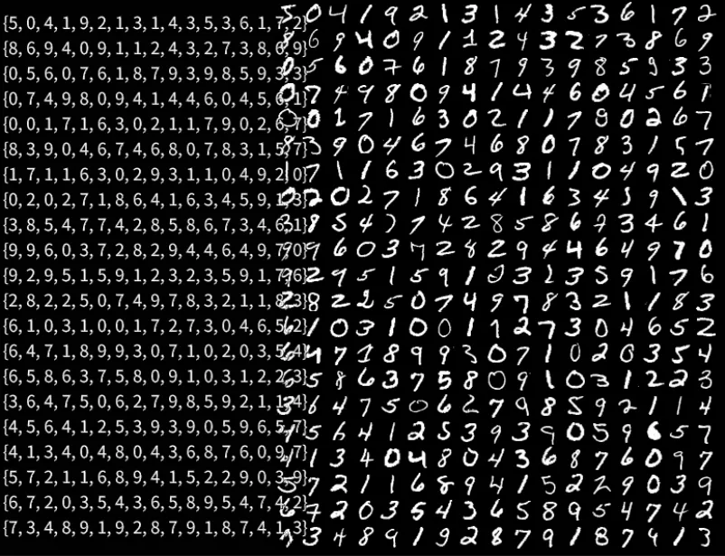

# MNISTを試しに描画する  
実際に試す前にMNISTの描画を行うところから.  

今回はSiv3Dで処理を行うということで、PythonのnumpyのようなものがSiv3Dにはないためそのままだと相当つらい...  
そのためちょっとライブラリを漁ってたんだけど、一番簡単そうなNumCpp[^1]というヘッダーオンリーライブラリを使っていくことにする.  
ヘッダーオンリーなので導入しやすいのが良い.  

ただ、このライブラリちょっと面倒なことにBoostを使っている...  
それくらいどうにかしなさいと言われたらごめんなさいと土下座をする必要があるが、どうも`define`でBoostなしにもできるっぽい.  
自分は`NumCpp.hpp`の一番上に

```c++
#define NUMCPP_NO_USE_BOOST
```

を書き込むことで回避した.  
これで無事使用の準備完了！実際に組み込んでいこう.  

まずはデータのダウンロードが必要.  
ということでMNISTをダウンロードしていく.  
まずラベルのKeyと拡張子を定義しておく.  
```c++
	protected:
		const String TRAIN_IMAGE = U"TrainImage";
		const String TRAIN_LABEL = U"TrainLabel";
		const String TEST_IMAGE = U"TestImage";
		const String TEST_LABEL = U"TestLabel";
		const String IMAGE_EXTENSION = U".idx3-ubyte";
		const String LABEL_EXTENSION = U".idx1-ubyte";
```
画像は`idx3`でラベルは`idx1`となる.  
画像は画像の枚数,画像のWidth,Heightの3次元なので3.  
ラベルは0\~9の1つのデータがずらっと並んでるだけの1次元なので1.  
というわけだ.  

そしたら初期化.  

```c++
TestMNIST::TestMNIST()
    : m_baseURL(U"https://ossci-datasets.s3.amazonaws.com/mnist/")
{
    m_resourceDir = FileSystem::CurrentDirectory() + U"Resource/";

    m_keyFileMap[TRAIN_IMAGE] = U"train-images-idx3-ubyte.gz";
    m_keyFileMap[TRAIN_LABEL] = U"train-labels-idx1-ubyte.gz";
    m_keyFileMap[TEST_IMAGE] = U"t10k-images-idx3-ubyte.gz";
    m_keyFileMap[TEST_LABEL] = U"t10k-labels-idx1-ubyte.gz";
}
```
ダウンロードするURLとキーを保存.  
リソースは現在のディレクトリに`Resource`というフォルダを作って、そこに放り込むことにする.  

そしたら初期化の処理.  
```c++
	bool TestMNIST::Initialize()
	{
		// Resourceフォルダの生成
		if (FileSystem::Exists(m_resourceDir))
		{
			FileSystem::CreateDirectories(m_resourceDir);
		}

		if (!DownloadMNIST()) { return false; }

		if (!LoadData()) { return false; }

		return true;
	}
```
リソースフォルダがなければまずリソースフォルダを用意する.  
次にデータをダウンロードしてなければダウンロード.  
そして、データをメモリに乗せる.  
これをやってるだけ.  

まずはデータのダウンロードから見てみる.  
先ほどkeymapに入れた`.gz`の名前を取り出し、それを使ってファイルパスを構築.  
もしデータが存在している場合はファイルが存在してるのでスキップ.  
なければダウンロードを行う.  
```c++
	bool TestMNIST::DownloadMNIST()
	{
		for (auto& [key, value] : m_keyFileMap)
		{
			auto filePath = m_resourceDir + value;

			// ファイルがある場合はすでにダウンロードされてる
			if (FileSystem::Exists(filePath)) { continue; }

			// MNISTをダウンロード
			auto downloadUrl = m_baseURL + value;
			if (!SimpleHTTP::Save(downloadUrl, filePath))
			{
				return false;
			}
		}

		return true;
	}
```

ダウンロードは`SimpleHTTP::Save`でSiv3Dでは簡単にできる.ここはありがたい.  
だが、`.gz`の解凍はないっぽい...？  
なんとかしてできないかなぁ...と思ったけど、無理だったのであきらめて手動で解凍しました.  
まあ,`.gz`なんていうちょっと特殊なzip解凍処理はないよねぇ...  
`.zip`とかならできるっぽいです.Siv3Dの名誉のためにこれは言いたかった.ただそれだけ.  

次はデータをメモリに乗せる処理.  
機械学習ではトレーニング用のデータとどれくらい学習できてるかを試すためのテストデータがある.  
そのため、この2つを読み込むようにする.  
```c++
	bool TestMNIST::LoadData()
	{
		auto filePath = m_resourceDir + TRAIN_IMAGE + IMAGE_EXTENSION;
		if (!LoadImageData(filePath, m_trainImages)) { return false; }

		filePath = m_resourceDir + TRAIN_LABEL + LABEL_EXTENSION;
		if (!LoadLabelData(filePath, m_trainLabels)) { return false; }

		filePath = m_resourceDir + TEST_IMAGE + IMAGE_EXTENSION;
		if (!LoadImageData(filePath, m_testImages)) { return false; }

		filePath = m_resourceDir + TEST_LABEL + LABEL_EXTENSION;
		if (!LoadLabelData(filePath, m_testLabels)) { return false; }

		return true;
	}
```
読み込むのはMNISTの場合は数字の描かれたデータとその数字が何番かを表すラベルの2つを読み込む.  
次はこの読み込みをしていく.  

まずはBinaryReaderでデータを読み込みを行う.  
```c++
	bool TestMNIST::LoadLabelData(const String& path, nc::NdArray<unsigned>& data)
	{
		BinaryReader reader = BinaryReader{ path };
		if (!reader) { return false; }
```
データの並びは正しい状態は`1234`なんだけど、入ってるデータは`4321`なので、ひっくり返すようにする.  
リトルインディアンってやつだね,頑張ってひっくり返せ～.  
```c++
		auto reverse = [](int32 i)
			{
				// Convert from c4 c3 c2 c1 to c1 c2 c3 c4
				unsigned char c1, c2, c3, c4;

				c1 = i & 255;
				c2 = (i >> 8) & 255;
				c3 = (i >> 16) & 255;
				c4 = (i >> 24) & 255;

				return ((int)c1 << 24) + ((int)c2 << 16) + ((int)c3 << 8) + c4;
			};
```

今回のデータはまず最初にマジックナンバーがあるため4byteを飛ばす.  
そして、その次の4byteにデータの枚数が入ってる.  
そのため、この枚数を`labelNum`に入れておく.  
```c++
		int32 labelNum;

		reader.skip(4); // MagicNumber
		reader.read(&labelNum, 4); labelNum = reverse(labelNum);
```
`data`はNumCppの`nc::NdArray<unsigned>`というデータ構造を使用する.  
こいつは最初は`std::vector`で`resize`とかをしてない状態と同じなので、`resizeFast`で`labelNum`のサイズに確定しておく.  
```c++
		data.resizeFast(1, labelNum);
```
あとは地道にデータを取っていくだけ.  
```c++
		for (int j = 0; j < labelNum; j++)
		{
			unsigned char v;
			reader.read(&v, 1);
			data[j] = v;
		}

		return true;
	}
```
これでLabelに関しては完了！  
ちゃんと読み込める.  

次は画像の読み込み、ほぼラベルと同じなので、まずは一気に流れを見よう.  
```c++
	bool TestMNIST::LoadImageData(const String& path, nc::NdArray<float>& data)
	{		
		BinaryReader reader = BinaryReader{ path };
		if (!reader) { return false; }

		auto reverse = [](int32 i)
		{
				// Convert from c4 c3 c2 c1 to c1 c2 c3 c4
				unsigned char c1, c2, c3, c4;

				c1 = i & 255;
				c2 = (i >> 8) & 255;
				c3 = (i >> 16) & 255;
				c4 = (i >> 24) & 255;

				return ((int)c1 << 24) + ((int)c2 << 16) + ((int)c3 << 8) + c4;
		};

		int32 imageNum, row, col;

		reader.skip(4); // MagicNumber
		reader.read(&imageNum, 4); imageNum = reverse(imageNum);
		reader.read(&row, 4); row = reverse(row);
		reader.read(&col, 4); col = reverse(col);

		data.resizeFast(imageNum, row * col);
		for (int j = 0; j < row * col * imageNum; j++)
		{
			unsigned char v;
			reader.read(&v, 1);
			data[j] = v;
		}

		return true;
	}
```
違う点はまずデータの入り方.  
マジックナンバーと画像の枚数までは同じ.  
その次に画像の縦のサイズと横のサイズも入っているので、ここれもParseしている.  

また、データリサイズは

* row: 画像枚数
* col: 画像データ:$`width \times height`$

という感じのデータを構築.  
NumCppは多次元配列を使えるのが魅力.  

さて、そしたら次はデータを画面上に出すようにしよう.  
まず画面サイズに合わせてデータを用意する.  
```c++
	void TestMNIST::Process(Array<double>& result)
	{
		ClearPrint();

		auto sceneSize = Scene::Size();
		result.resize(sceneSize.x * sceneSize.y, 1.0);
```
今回のMNISTはサイズとして`28x28`というサイズになっている.  
これを敷き詰めるようにデータを配置する.  
そのためにオフセットを使って調整を行う.  

`xOffset`はラベルを表示したいのでちょっとずらしてるだけ.  
そして、描画できる量を28で割って求める.  
```c++
		constexpr int xOffset = 300;
		const int xPlaceNum = (sceneSize.x - xOffset) / 28;
		const int yPlaceNum = (sceneSize.y) / 28;

```

まず画像を適当に引っ張り出して、画像のデータを

* row:画像のwidth
* col:画像のheight

となるように加工.  
```c++
		// Testデータを試しに描画してみる
		for (auto y = 0; y < yPlaceNum; y++)
		{
			for (auto x = 0; x < xPlaceNum; x++)
			{
				auto data = m_trainImages.row(y * xPlaceNum + x);
				data.reshape(28, 28);
```
後はベース位置を求めてデータを敷き詰めればOK.  
```c++
				auto basePoint = xOffset + x * 28;
				basePoint += sceneSize.x * 28 * y;
				for (int r = 0; r < 28; r++)
				{
					for (int c = 0; c < 28; c++)
					{
						result[basePoint + (c + r * sceneSize.x)] = data.row(r)[c];
					}
				}
			}
		}
```
これで画像の描画をするための用意が終わった.  

次はラベル,これはデータを取り出して`labels`に詰め込む.  
```c++
		// Testのラベルも列枚に描画してみる
		Array<unsigned> labels;
		for (auto y = 0; y < yPlaceNum; y++)
		{
			for (auto x = 0; x < xPlaceNum; x++)
			{
				auto data = m_trainLabels.column(y * xPlaceNum + x);
				labels.push_back(data[0]);
			}
```
あとは今回は`Print`関数で描画するだけにしよう.  
```c++
			Print << labels;
			labels.clear();
		}
	}
```

一応画像に書き込むところも見ておこうか.  

```c++
for (int h = 0; h < m_image->height(); h++)
{
    for (int w = 0; w < m_image->width(); w++)
    {
        double value = result[w + m_image->width() * h] / 255.0;
        (*m_image)[h][w] = ColorF{ value, value, value, 1.0 };
    }
}
```
先ほど作ったデータは`result`に入っているため、ここの値を取り出す.  
取り出した値は$`value \in [0,255]`$なので、$`[0,1]`$になるように調整をする.  
その後、その値を`m_image`に書き込めば終わり.  
この画像を描画すれば結果が見れる寸法.では実際に見てみようか.  

  

おお、いい感じに描画されてる！！  
横の数字と元の画像を比較するとちゃんとあってそうなのでよかった～.  
ということでなんとか最初の準備は整いました！  

[^1]: [NumCpp](https://github.com/dpilger26/NumCpp)  