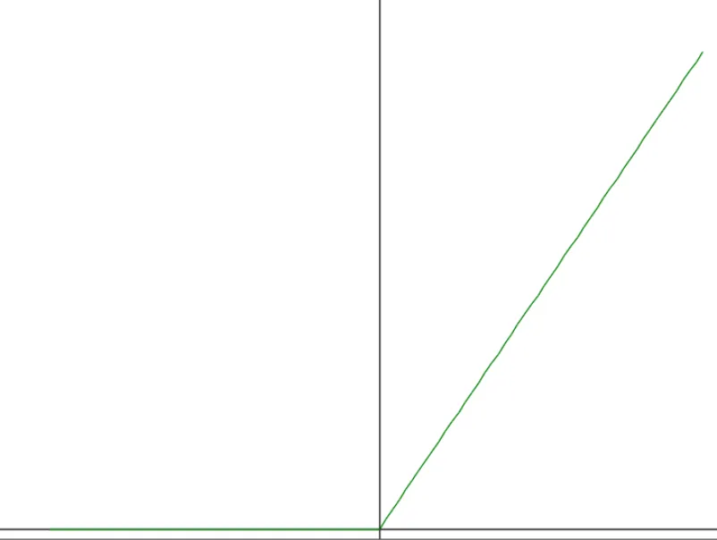

# ReLU関数  
これも活性化関数,rectified linear unitの略らしい[^1].  
式は以下の形になる,非常にシンプル.  

```math
h(x)=
\begin{cases}
x & (x > 0) \\
0 & (x \le 0)
\end{cases}
```
実装は以下のような感じ.  

```c++
	void ReLU::Function(float& value) const
	{
		value = Max(0.0f, value);
	}
```

これでプロットしたグラフは以下の形.  

  

負の範囲なら0,それ以外はそのまま出力といった感じ.  
この活性化関数も後程使うかもしれない.  

[^1]: [正規化線形関数](https://w.wiki/4Jip)  