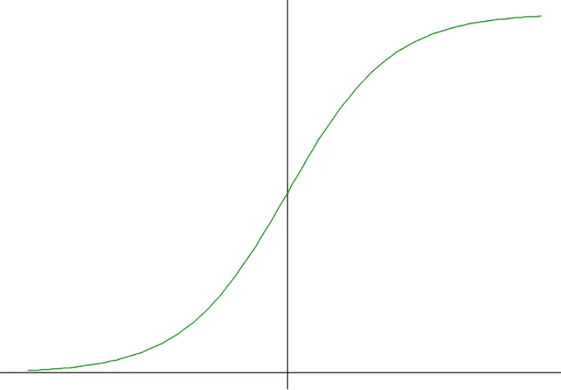
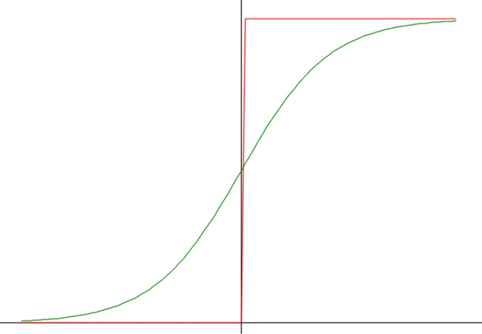

# Sigmoid関数  
次の活性化関数はシグモイド関数.  
形は以下の感じ.  

```math
h(x) = \frac{1}{1+ \exp{(-x)}}
```

コードでは以下のような感じで実装.そのまま～.  
```c++
	void Sigmoid::Function(float& value) const
	{
		value = 1.0f / (1.0f + Exp(-value));
	}
```
さて、実際に描画したのが以下.  

  

ちょっと滑らかな感じになってる！  
stepと並べて描画してみよう.  

  

stepとsigmoidどちらも値を$`[0,1]`$に押しとどめるというのは同じ.  
違うのは滑らかさ.  
Stepは0 or 1なので、滑らかではなくかくっとしてる.  
それに対してSigmoidは滑らか.  
この滑らかさが後々重要になってくる!    