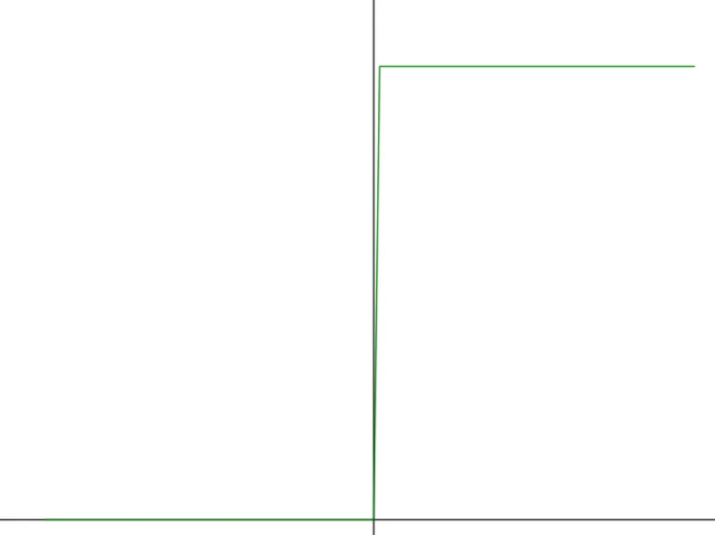

# Step関数  
DeepLearningではよく活性化関数が使われる.  
簡単に言えば

```math
y = h(x)
```

みたいな感じで入力$`x`$を活性化関数$`h`$に入力することで、次の出力を決める役割.  
この$`h`$としてよく使われるものにステップ関数がある.  
まずはこいつを見ていこう.  

ステップ関数はもうコードで見るのが速い.  

```c++
	void StepFunction::Function(float& value) const
	{
		value = static_cast<float>(value > 0);
	}
```

はい、単純に0より大きければ1,そうでなければ0.  
これだけである.  
実際に描画したのが以下.  

  

うん、一気に跳ね上がるような感じだね.  
階段状に切り替わるので階段関数といわれることもある.  
shaderでもパきっと切り替えたいときによく使われる関数だ.  