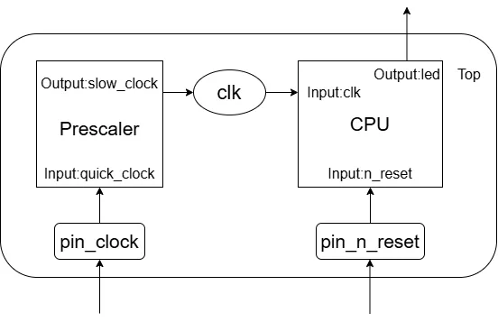
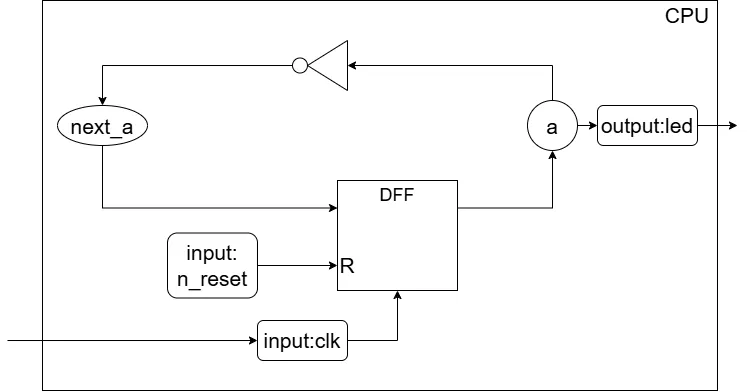
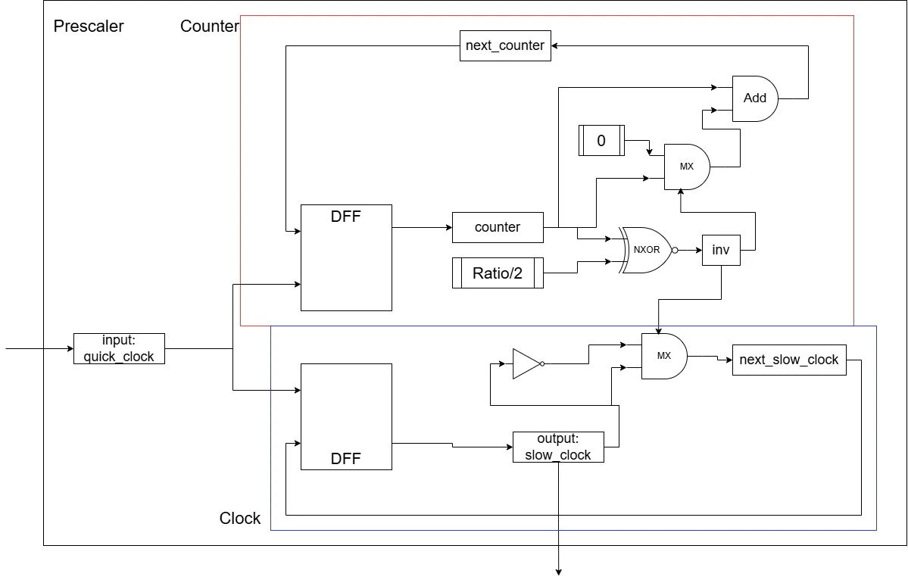
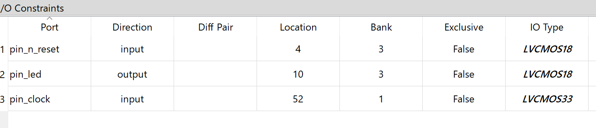
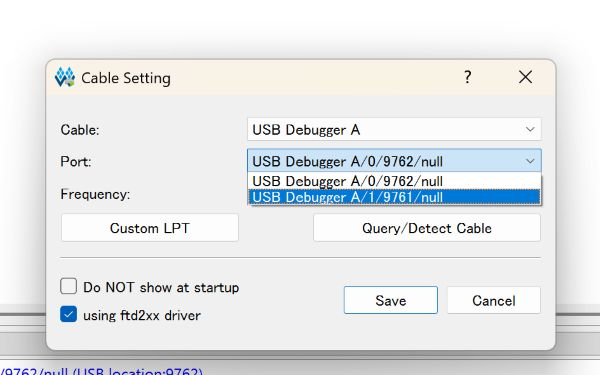
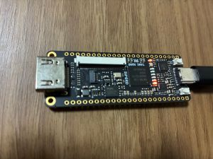

# TangNano9kでシンプルなCPUを作ってみる その1: Lチカ  
漠然と作りたくなったんですよ、CPU.  
そういう時ってあるよね、これが低レイヤー沼ってやつですねわかります.  
ということで今回はこちら[^1]の本のTD4を作っていくことで、CPUを作りつつFPGAの扱いに慣れようという感じだ.  
そういえばこの本、名著と名高いメイド本[^2]の内容の再現なんですね.  
メイド本、未だに手を出してないんだよなあ.そっちを買えという意見があると非常に耳が痛いですが、右から左に流したいと思います.  

さて、まず最初はLチカ、以前にLチカやったけど[^3]今回はまた復習がてらこいつをやろう.  
Hello Worldは何度やってもいいですからね、ええ.  

今回作るのはこんな感じ.  

  

クロックとリセットボタンを用意して、Ledに出力するだけ.  
簡単ですね,これだけであれば前回とほぼ同じ.  
ただちゃんと区分けしてるので、CPU感があふれている.  
こういうのって大事よね.  
モジュールは

* Prescaler: クロックを制御
* CPU: メインの処理
* Top: すべてを統合したもの

といった感じ.  
この3つを作れば今回は目的達成となる.  

さて、まず最初にCPUから作っていこうか.  
CPUの詳しい構造は次のような感じ.  

  

まず入力はリセットボタンとクロック.  
出力はLEDに出す.  
これをもとにしたmodule定義が以下.  
```verilog
module cpu
(
    input  logic clk,               // input: クロック
    input  logic n_reset,           // input: リセットボタン
    output logic led                // output: LED 
);
```
そして、モジュール内のワイヤーである`a`と`next_a`を定義
```verilog
    logic a, next_a;  // モジュール内のワイヤー
```

さて、DFFはフリップフロップで基本的に値を記録するわけだが,aが記録した値.  
基本的にリセットボタンが押されたら強制1.  
押されてないならクロックの立ち上がり毎に`next_a`を注入する.  
クロックが立ち上がって`next_a`が注入されるまで、値の変化は起きないので問題ないというわけだ.  
```verilog
    // DFF
    always_ff @(posedge clk) begin
        if (~n_reset) a <= 1'b0; // リセットされてたら1を注入
        else a <= next_a; // クロック立ち上がり時に反転したものを注入
    end
```
LEDは`a`の値を出力すればよい.  
クロック立ち上がり毎に0,1,0,1と変化するので、Lチカになるわけだ.  
```verilog
    assign led = a; // aの状態を出力
```
not演算子は真理値表で定義.  
`~`が`not`に相当なので、普通に`~a`を放り込めばOK.  
```verilog
    always_comb begin
        next_a = ~a; // notゲートによる接続
    end
endmodule
```
これがCPUの全貌、そこまで難しくないですね.  

次にPrescalerを見よう.  

  

本にはなかったので自分で読み解きつつそれっぽく図を作ってみた.  
やってることは簡単で、まず入力と出力を用意.  
```verilog
module prescaler #(parameter RATIO = 2)
(
    input  logic quick_clock,
    output logic slow_clock 
);
```
次に配線となる`counter,next_counter,inv`の用意.  
この後に`==`で値が$`\frac{RATIO}{2}`$になってるか確認を`inv`に入れた後、マルチプレクサに流し込んでカウントするかを決定.  
基本的には`inv=false`なので、カウントするだけだが,`inv=true`となったときのみ`0`にリセットする.  
これで高速なクロックではなく、ある程度の時間でクロックするように調整しているわけである.  
因みに`0->1`と`1->0`で1クロックなので、RATIOを2で割ってるものだと思う.  
最後にDFFでcounterの値を保持すれば終わり.  
```verilog
    logic [31:0] counter, next_counter;
    logic inv;
    assign inv = (counter == (RATIO/2 - 1));

    assign next_counter = inv ? 32'd0 : counter + 32'd1;
    always_ff @(posedge quick_clock) counter <= next_counter;

```
出力する`slow_clock`は単純に`inv=true`になるときのみクロックを反転させる.  
これで高速なクロックを遅くしてるわけだ.  
最後に`slow_clock`自体はDFFで保持すればOK.  
```verilog
    logic next_slow_clock;
    assign next_slow_clock = inv ? ~slow_clock : slow_clock;
    always_ff @(posedge quick_clock) slow_clock <= next_slow_clock;
endmodule
```

Topは簡単、つなげるだけ.  
ただ、TangNano9kのクロック数は27MHzなので、そこは注意.  
```verilog
module top
(
    input  logic pin_clock,     // input: クロック
    input  logic pin_n_reset,   // input: リセットボタン
    output logic pin_led        // output: LED
);
    logic clk;
    prescaler #(.RATIO(27_000_000)) prescaler
    (
        .quick_clock(pin_clock),
        .slow_clock(clk)
    );

    cpu cpu(.clk, .n_reset(pin_n_reset), .led(pin_led));
endmodule
```
そしたら配線、ほぼ前回と変わらない.  
LEDの数が減ったくらい.  

  

次に書き込みだけど、以前に行ってた1の設定の奴はこれ.  

  

`USB Debugger A/1/9761/null`ってやつ、これにしないと怒られる.  
そしたら結果.  

  

うん、いい感じだね.  
LEDが一つに減ったことで光るところが1つになりました.  
いいでしょう.  

今回はこんなところで終わりかな.  

[^1]: [作ろう！CPU 基礎から理解するコンピューターのしくみ](https://book.mynavi.jp/ec/products/detail/id=116654)  
[^2]: [CPUの創りかた](https://book.mynavi.jp/ec/products/detail/id=22065)  
[^3]: [Tang Nano 9kでLチカをやってく](./TangNano_LBlink.md)  