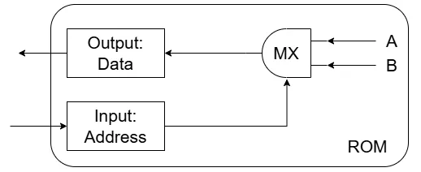
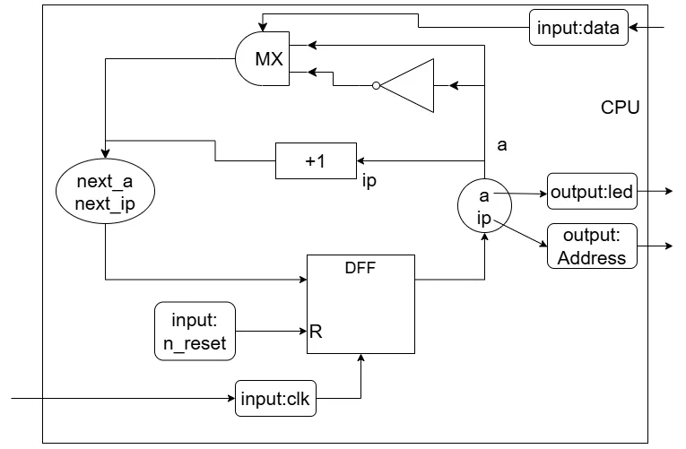
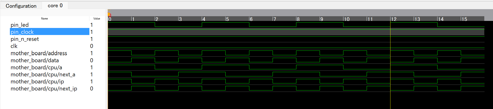

# TangNano9kでシンプルなCPUを作ってみる その2: 1bit CPU  
今回は1bit CPUをやっていく.  
まずはCPUの`a`と`next_a`の部分を前回と今回で見比べよう.  

  

前回は単純なNot演算子をDFFに繋いでいた.  
これに対して今回はNotの後にマルチプレクサをつないで`next_a`につなげる.  
こうすることで

* MXに0の信号: `a`をそのまま流す
* MXに1の信号: `~a`を流す

といったようなことをしていることになる.  

さて、アセンブリを思い出そう.  
実はこの命令にはアセンブリの命令との関連がある.  

| 機械語| アセンブリ | next_a |
| :---: | :---:| :---: |
| 0 | NOP | a |
| 1 | NOT | ~a |

今回で言う機械語はMXに流し込まれる信号のことだ.  
これが0ならNOP命令に対応し、結果として`next_a=a`となる.  
何も変わらないのでDFF側が1になっても変化が起きないことになる.  

これが1ならNOT命令に対応し、結果として`next_a=~a`となる.  
これはDFF側が1になったときに前回の回路図を見ればわかる通り、`a <= next_a;`より変化が起こることになる.  

こんな風にMXに機械語で命令を流し込んで命令を実行する.  
これが今後のCPUでやりたいことだ.  

そしたら新しく拡張する構造を見てみよう.  

  

CPUがちょっと拡張されて、新しくROMという構造が出現.  
このROMにアドレスを流し込み、機械語を出力するということになる.  
基本的に回路設計ではCPUを作って、プログラマが書いたプログラムをコンパイルなどしてアセンブリとした後最終的に機械語まで落とし込んだら、これが命令群となる.  
`Address`でどの命令を使うかを決めて、それからROMから取り出した命令が`data`に流し込まれて次の命令へ...とするのが主な構造.  
まあそこまで細かいのは今後見ていくのでよいとして、今回はとりあえずROMで指定されたアドレスを指定したら命令が流されるという構造を作ることを考えよう.

今回作るROMはこんな感じ.  

  

Addressで読みだす位置を決める.  
今回は1bitなので、0 or 1の2つのアドレスが決められる.  
これは

* アドレス0: A
* アドレス1: B

という風に決まっており、このアドレスの信号がMXに渡ってAとBが決まることになる.  
AとBは4パターンに分けられて、以下のようになる.  

| 命令A | 命令B |
| :---: | :---:|
|0 |0|
|1|0|
|0|1|
|1|1|

これがdataに流されるわけだけど、これが0ならNOP,1ならNOTとなる.  
Lチカにおいて、

* NOP: ずっと点灯 or ずっと消灯
* NOT: 点灯と消灯を繰り返す

といった関係にあるため,両方とも0の場合はチカチカしない状態になってしまう.  
逆に両方1は毎回チカチカ、どっちかが0ならチカチカとストップを繰り返すので両方1の半分の周期ということだ.  
今回は

* A: 1
* B: 0

のものを採用しよう！  
これを先ほどの機械語と合わせると次のような図を考えられる.  

| アドレス| 命令(機械語) | アセンブリ |
| :---: | :---:| :---: |
| 0 | 1 | NOT |
| 1 | 0 | NOP |

なんかアドレス感はないけど、まあそれはメモリから引っ張ってくるとかしてないからというのもある.  
致し方なし.  

さて、そしたら実際にコードを組んでみよう.  
module名は`rom`.  
入力は`address`で出力は`data`.  
```Verilog
module rom
(
    input  logic address,               // input: 命令のアドレス
    output logic data                   // output: 出力
);
```
条件は論理式で書くため、`alway_comb`で行う.  
switch文の要領で組み込めばよい.  
これがマルチプレクサとなる.  
`address`が0の電流なら読みだした1を流す.  
`address`が1の電流なら読みだした0を流す.  
これが命令であり、機械語となるわけだ.  
```Verilog
    always_comb begin
        case (address)
            1'b0: data = 1'b1; // 0: NOT命令
            1'b1: data = 1'b0; // 1: NOP命令
        endcase
    end
endmodule
```
これでRom側は終わり！  

さて、次は改造したCPUの構造を見てみよう.  

  

分けて考えよう.  
まずaについて、これは前回とほぼ同じ.  
ROMから流されたdataがマルチプレクサに流し込まれて、NOPとNOTのどちらかになるが、それ以外は同じ.  

* 前回: NOTのみ
* 今回: NOP or NOT

といった感じの違いかな.  

そして、アドレスに関してはipというもので決まる.  
instruction pointerの略でipだね.  
現状は+1でクロック毎に値が変わる感じ.  
つまり,$`0,1,2,3,4...`$となるわけだが、今回は1bitなのを思い出してほしい.  
1bitで表せるのは$`0,1`$のどちらか.  
つまり、$`0,1,0,1,0...`$となるわけだ.  
これはアドレスで言うと,

* Addr:0 -> NOT
* Addr:1 -> NOP
* Addr:0 -> NOT
* Addr:1 -> NOP
* Addr:0 -> NOT

という風にアドレスを読み込んで命令をしてるのと同じ.  
これでROMとCPUが繋がれた！！  

さて、実際にコードにしておこう.  
モジュールは単純にアドレスとデータが追加されている.  
```verilog
module cpu
(
    input  logic clk,               // input: クロック
    input  logic n_reset,           // input: リセットボタン
    input  logic data,              // input: データ
    output logic address,           // output: アドレス
    output logic led                // output: LED 
);
```

ワイヤーはipの部分を追加.  
```verilog
    // モジュール内のワイヤー
    logic a, next_a;
    logic ip, next_ip;
```

論理式は基本的に`a`と`ip`にnextのものを流し込むだけ.  

```verilog
    // DFF
    always_ff @(posedge clk) begin
        if (~n_reset) begin
            // リセット時
            a <= 1'b0;
            ip <= 1'b0;
        end else begin
            // 平常時
            a <= next_a;
            ip <= next_ip;
        end      
    end
```
addressにはipを流し込む.  
```verilog
    assign led = a; // aの状態を出力
    assign address = ip; // ipの状態を出力
```
`next_a`はROMから読みだした命令が`data`に入ってるので、これをいれるだけ.  
`next_ip`は$`+1`$するだけ.  
```verilog
    always_comb begin
        case (data)
            1'b0: next_a = a;   // 0: NOP
            1'b1: next_a = ~a;  // 1: NOT 
        endcase
        next_ip = ip + 1'b1; // next_ip++
    end
endmodule
```

これで完了.  

CPUには大事なROMができたことで、これを統合した構造を作っておく.  

もう一度図を見ておこう.  

  

CPUとROMをまとめたものがmother_board.  
単純に分けたモジュールを並べただけ.  
ハード側はCPUを作る,ソフト側はコードを書いて命令を作りROMに焼く.  
これをmother_boardで橋を架けてる感じなわけだ.  

このコードは簡単なので、一気にコードを載せておく.  
```verilog
module mother_board
(
    input  logic clk,       // input: クロック
    input  logic n_reset,   // input: リセットボタン
    output logic led        // output: LED
);
    // モジュール内のワイヤー
    logic address;
    logic data;

    // モジュールの埋め込み
    cpu cpu(.clk, .n_reset, .address, .data, .led);
    rom rom(.address, .data);

endmodule
```
本当につなぐだけ.  

あとはtopを見返しておこう.  
書き換えるのは1行だけ.  
```verilog
mother_board mother_board(.clk, .n_reset(pin_n_reset), .led(pin_led));
```
前回はCPUだった部分をmother_boardにするだけ.  
これだけでOK!!  

今回は波形を描画してみよう.  
ちゃんとシミュレーションをするのは大変.  
GowinにはAnalyzer Oscilloscope[^1]というものがあり、これを使うとちょっと楽.  
シミュレーションはできないけど、実際に実行して波形を見れる.  
ただし、クロックの立ち上がりか立下りのどちらか駆動なためクロック自体は見ることが不可能.そこを見たい場合はシミュレーションなんだろうなぁ.  

さて、自分がやった手順は非常に明快.  
gaoファイルを作る、読み取りたい条件を設定してからTangNano9kを接続してAnalyzer Oscilloscopeに流すだけ.  
この結果が以下.  

  

* addressが1のとき、dataは0.  
これはちゃんと命令を発行できてるね.  

* ipとaddressが協調してるのはのも正しそう.  
* aとnext_aの関係もわかりやすいね.  
立ち上がりで変化が起きる、これはNOT命令.  
その後同じ状態が1命令だけ続く.これはNOP命令.  
ちゃんと命令も問題なさそう.  

こんな風に波形を見ればいろんな情報を収集できる.  
デバッグに仕える非常に便利なものだ！  
さて、これで一旦終了.  
次回は多重ワイヤー.  

[^1]: [Tang-NanoでAnalyzer Oscilloscopeを使ってみる](https://qiita.com/hi631/items/334b4ef61def04667ec3)  