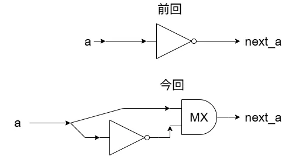
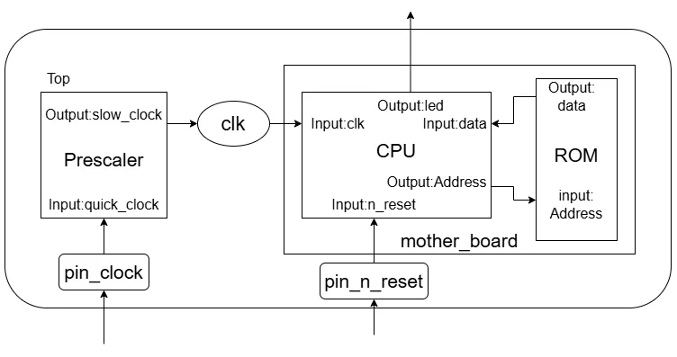

# TangNano9kでシンプルなCPUを作ってみる その2: 1bit CPU  
今回は1bit CPUをやっていく.  
まずはCPUの`a`と`next_a`の部分を前回と今回で見比べよう.  

  

前回は単純なNot演算子をDFFに繋いでいた.  
これに対して今回はNotの後にマルチプレクサをつないで`next_a`につなげる.  
こうすることで

* MXに0の信号: `a`をそのまま流す
* MXに1の信号: `~a`を流す

といったようなことをしていることになる.  

さて、アセンブリを思い出そう.  
実はこの命令にはアセンブリの命令との関連がある.  

| 機械語| アセンブリ | next_a |
| :---: | :---:| :---: |
| 0 | NOP | a |
| 1 | NOT | ~a |

今回で言う機械語はMXに流し込まれる信号のことだ.  
これが0ならNOP命令に対応し、結果として`next_a=a`となる.  
何も変わらないのでDFF側が1になっても変化が起きないことになる.  

これが1ならNOT命令に対応し、結果として`next_a=~a`となる.  
これはDFF側が1になったときに前回の回路図を見ればわかる通り、`a <= next_a;`より変化が起こることになる.  

こんな風にMXに機械語で命令を流し込んで命令を実行する.  
これが今後のCPUでやりたいことだ.  

そしたら新しく拡張する構造を見てみよう.  

  

CPUがちょっと拡張されて、新しくROMという構造が出現.  
このROMにアドレスを流し込み、機械語を出力するということになる.  
基本的に回路設計ではCPUを作って、プログラマが書いたプログラムをコンパイルなどしてアセンブリとした後最終的に機械語まで落とし込んだら、これが命令群となる.  
`Address`でどの命令を使うかを決めて、それからROMから取り出した命令が`data`に流し込まれて次の命令へ...とするのが主な構造.  
まあそこまで細かいのは今後見ていくのでよいとして、今回はとりあえずROMで指定されたアドレスを指定したら命令が流されるという構造を作ることを考えよう.  