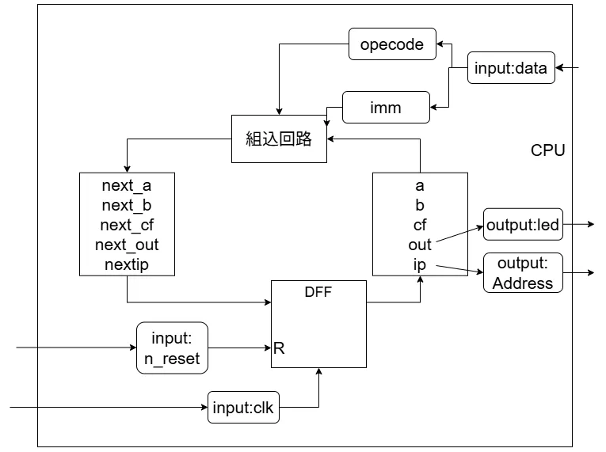

# TangNano9kでシンプルなCPUを作ってみる その3: TD4  
さて、ついに4bitのCPUにしていく.  
まずはレジスタの対応を見ていこう.  
1bitの場合と比較してみる.  

|  | TD4 | 1bit |
| :---: | :---:| :---: |
| 汎用レジスタ | a(4),b(4) | a(1) |
| IOレジスタ | out(4) | a(1) |
| 命令ポインタ | ip(4) | ip(1) |
| フラグレジスタ | cf(1) | なし |

一つずつ見ていこう.  

汎用レジスタなんにでも使えるレジスタ、作業用.  

IOレジスタは入出力用、今回は出力に4bit用意する予定.  
前回はそのまま出力してたので、汎用レジスタだったんだねここ.  

命令ポインタ,アドレスを保持するレジスタと思えばよいね.  

フラグレジスタ、桁あふれ検知用.  
キャリーフラグってやつか.  
OS自作の時も良くお世話になりました.  

これでレジスタ構造が明らかになったので、次はCPUの拡張.  
今回は次のような形になる.  

  

まずレジスタとして`b,cf,out`が追加された.  
今までは`a`が出力だったが、今回からは`out`を出力するようになる.  
レジスタの構造としてはそれ以上に変わったことはない.  

入力されるデータはさらに分割されて、`opecode`と`imm`になる.  
要は`data`は8bitのデータで、`opecode`が上位4bit,`imm`が下位4bitと分割されるわけだ.  

実際に本だとさらに追加でswitchという入力があった.  
が、これはTangNano9kだとそもそも入力としてはSwitch2つしかないし、1つはresetに取られてる始末.  
あまりにもそれだと寂しいので、今回はSwitchは組み込まない形状にしてみた.  
固定値になるけど、形はシンプルになったのでまあいいか...の精神.  

さて、そしたらCPUのコードを組んでみよう.  
まずは今までの図の中のコードをモジュールとワイヤーで用意！  
スイッチは使わないのでコメントアウトしてます.  
```verilog
module cpu
(
    input  logic clk,               // input: クロック
    input  logic n_reset,           // input: リセットボタン
    input  logic [7:0] data,        // input: データ
    // input  logic [3:0] switch,      // input: スイッチ
    output logic [3:0] address,     // output: アドレス
    output logic [3:0] led          // output: LED 
);

    // モジュール内のワイヤー
    logic [3:0] a, next_a;          // 汎用レジスタ
    logic [3:0] b, next_b;          // 汎用レジスタ
    logic cf, next_cf;              // キャリーフラグ
    logic [3:0] ip, next_ip;        // 命令ポインタ
    logic [3:0] out, next_out;      // LED接続
```
次はフリップフロップ、これも前回のを拡張するだけ.  
```verilog
    // DFF
    always_ff @(posedge clk) begin
        if (~n_reset) begin
            // リセット時
            a <= '0;
            b <= '0;
            cf <= '0;
            ip <= '0;
            out <= '0;
        end else begin
            // 平常時
            a <= next_a;
            b <= next_b;
            cf <= next_cf;
            ip <= next_ip;
            out <= next_out;
        end      
    end
```
`data`は上位4bitが`opecode`,下位4bitが`imm`でした.  
これに従ってassignを行う.  
```verilog
    logic [3:0] opecode, imm; // 命令と即値
    assign opecode = data[7:4]; // データから命令を接続
    assign imm = data[3:0]; // データから即値を接続
```
最後に`address`と`led`に出力をつなぐ.  
```verilog
    assign led = out; // outの状態を出力
    assign address = ip; // ipの状態を出力
```
さて、そしたら組み込み回路.  
こいつが中々なもの.  
まず最初に初期値を設定する.  
これは`NOP`命令に相当,何もしてないのと同じ.  
```verilog
    always_comb begin
        next_a = a;             // 汎用レジスタはそのままの値
        next_b = b;             // 汎用レジスタはそのままの値
        next_cf = 1'b0;         // キャリーフラグは0
        next_ip = ip + 4'd1;    // ipは1増やす
        next_out = out;         // LEDは現在の状態
```
次に命令を作成する.  
`opecode`で0\~15の数字を命令と結びつける作業である.  
今回は以下のような命令を実際に実装した.  
```verilog
        unique case (opecode)
            4'b0000: {next_cf, next_a} = a + imm;       // 0: add A, imm
            4'b0101: {next_cf, next_b} = b + imm;       // 5: add B, imm
            4'b0011: next_a = imm;                      // 3: mov A, imm
            4'b0111: next_b = imm;                      // 7: mov B, imm
            4'b0001: next_a = b;                        // 1: mov A, B
            4'b0100: next_b = a;                        // 4: mov B, A
            4'b1111: next_ip = imm;                     // 15: jmp imm
            4'b1110: next_ip = cf ? ip + 4'd1 : imm;    // 14: jnc imm
            // 4'b0010: next_a = switch;                   // 2: IN A
            // 4'b0110: next_b = switch;                   // 6: IN B
            4'b1001: next_out = b;                      // 9: OUT B
            4'b1011: next_out = imm;                    // 11: OUT imm
            default: ;
        endcase
    end
```
switch関係の命令はいらないので省略した.  
やってることはコードを読めばわかるので、アセンブリの命令表だけ列挙しておく.  

| opecode | アセンブリ |
|:---: | :--- |
| 0000 | add A, imm |
| 0001 | mov A, B |
| 0011 | mov A, imm |
| 0100 | mov B, A |
| 0101 | add B, imm |
| 0111 | mov B, imm |
| 1001 | out B |
| 1011 | out imm |
| 1110 | jnc imm |
| 1111| jmp imm |

うん、アセンブリをやったことあれば機械語との対応はそこまで難しくないね.  
アドレスがジャンプするのとか、実際の動作としては`ip=imm`みたいに直接指定してるのと変わらないということだ.  

さて、そしたら最後にROM.  
ここに命令を打ち込んでいく.  
今はコンパイラとかはないので、あくまで真心を込めた手打ちをしていくことになる.  

まずROMのデータは入力にアドレスを取って、出力にデータを取る.  
```verilog
module rom
(
    input  logic [3:0] address,               // input: 命令のアドレス
    output logic [7:0] data                   // output: 出力
);
```
アドレスの数値をみて実際の処理を読み込んでいけばよい.  
これは結構簡単.  
```verilog
    always_comb begin
        case (address)                    // address  data  operate
            4'b0000: data = 8'b0111_1010; // 0        7A    mov B, 10
            4'b0001: data = 8'b1001_0000; // 1        90    OUT B
            4'b0010: data = 8'b0011_1101; // 2        3D    MOV A, 13
            4'b0011: data = 8'b0000_0001; // 3        01    ADD A, 1
            4'b0100: data = 8'b1110_0011; // 4        E3    JNC    3
            4'b0101: data = 8'b0101_0001; // 5        51    ADD B, 1
            4'b0110: data = 8'b1110_0001; // 6        E1    JNC    1
            4'b0111: data = 8'b1011_0000; // 7        B0    OUT    0
            4'b1000: data = 8'b1011_1111; // 8        BF    OUT    15
            4'b1001: data = 8'b1111_0111; // 9        F7    JMP    7
            default: data = 8'b0000_0000;
        endcase
    end
endmodule
```

これだけ見ても何のこっちゃとなるので、部分部分で見ていこう.  

まず最初はここ
```verilog
4'b0000: data = 8'b0111_1010; // 0        7A    mov B, 10
```
`mov B, imm`の命令で即値が10なので、Bに10を代入している.  
実際のところ本だとここはswitchによる制御だけど、まあ関係ないね.  

次はここ.  
```verilog
4'b0001: data = 8'b1001_0000; // 1        90    OUT B
4'b0010: data = 8'b0011_1101; // 2        3D    MOV A, 13
4'b0011: data = 8'b0000_0001; // 3        01    ADD A, 1
4'b0100: data = 8'b1110_0011; // 4        E3    JNC    3
4'b0101: data = 8'b0101_0001; // 5        51    ADD B, 1
4'b0110: data = 8'b1110_0001; // 6        E1    JNC    1
```
これを適当に疑似コードで書くなら次のような感じ.  
```c++
do
{
    out(B); // 1: LEDに値を出力

    a = 13; // 2: 13をAに代入
    do
    {
        a++; // 3: A++をする
    }while(a < 16); // 4:条件を満たしてないなら1へ

    b++; // 5: B++をする
}
while(b < 16); // 6: 条件を満たしてないなら1へ
```
コードと結びつけるとかなりわかりやすいね.  

さて、最後の3行も見よう.  
```verilog
4'b0111: data = 8'b1011_0000; // 7        B0    OUT    0
4'b1000: data = 8'b1011_1111; // 8        BF    OUT    15
4'b1001: data = 8'b1111_0111; // 9        F7    JMP    7
```
これもコードに対応させてみよう.  
```c++
do
{
    // Lチカ
    out(0); // 7
    out(15); // 8
} while(true); // 9: ずっとループ
```

こんな風に時間を計ってLEDに値を出力をしてるコードなわけだ.  
時間について考えてみよう.命令を見ると、

* LEDに値を設定: +1s
* Aを1回足す:+1s 
* Aが2命令を3回繰り返す:+6s
* Bを1回足す:+1s
* Bの判定:+1s

となる.  
つまり、1ループが10sとなっていて、Bが10に設定されているので、60秒を数えるコードと言える！  
60秒を数えた後はLチカで終了を知らせるわけだ.  

こう見るとシンプルですね、例のメイド本もこれを作るのが目標だったらしい.  
ということで4bitCPUの原型はできた！  
次はこれを改良していこうかなと思う.  