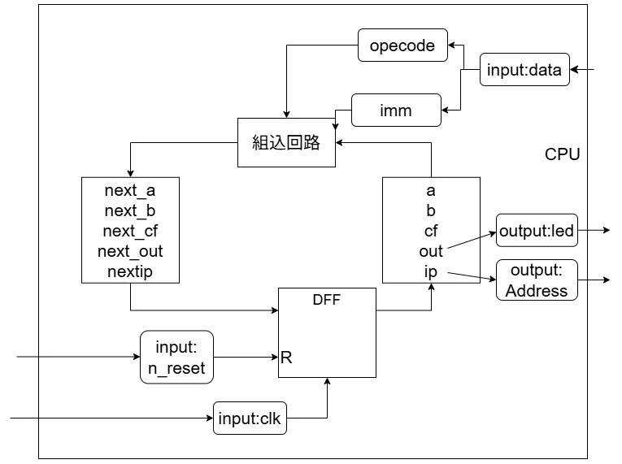
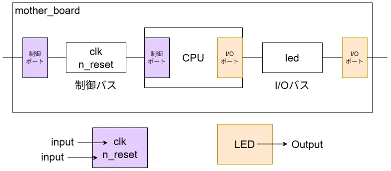
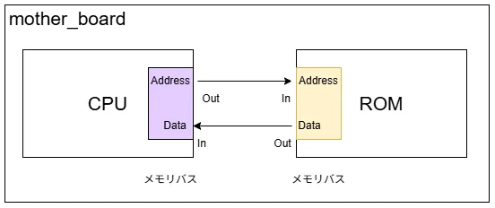
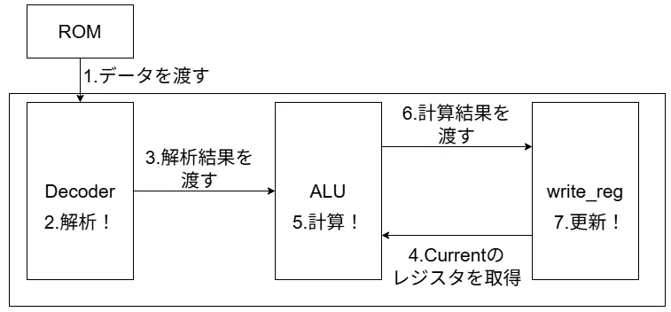

# TangNano9kでシンプルなCPUを作ってみる その4: 使いやすいように拡張  
今回でSimpleCpuは一旦終了.  
前回でTD4ができたので、実際に使いやすくするために拡張を行っていく.  

まずは入出力周りが結構ごちゃっとしてる.  

  

この中で特に

* リセットボタン
* クロック
* LED

という部分に着目する.  
これはクロックの同期や処理の合わせる制御を司る「制御バス」とキーボードやらディスプレイやらとの接続を司る「I/O」バスの二つがある.  
これを実際に図にすると次のような感じ.  

  

制御バスはクロックとボタンというメンバを持っており、両方入力方向.  
そのため、このメンバをまずinterfaceで用意.  
その後、ポートに関しては入力として定義すればＯＫ.  
```verilog
// 制御用バスのインターフェース
interface ctrl_bus_if();
    logic clk;      // クロック
    logic n_reset;  // リセットボタン

    // 両方入力として定義
    modport master(input clk, input n_reset);
endinterface
```

I/Oバスについて.  
こちらはメンバとしてledのみ.  
そして、方向は出力となるように設定すればよい.  
今回のLEDは4つなので、4本のワイヤーが必要.  
そのため、`WIDTH`というパラメータで指定できるようにする.  

```verilog
// 入力用バスのインターフェース
// 入力としてビット数をWIDTHとして設定できるように
interface io_bus_if #(parameter WIDTH) ();
    logic [WIDTH-1:0] led;      // LED

    // LEDは出力
    modport master(output led);
endinterface
```

ここまで2つのバスが書けた！  

次はバスを適用させていく.  
まずはtopにバスを書いて、mother_boardに渡す.  
`WIDTH`は4bit CPUなので、4を指定すればよい.  
```verilog
    // 制御用バス
    ctrl_bus_if ctrl_bus();
    assign ctrl_bus.clk = clk;
    assign ctrl_bus.n_reset = pin_n_reset;

    // 入力用バス
    io_bus_if #(.WIDTH(4)) io_bus();
    assign pin_led = io_bus.led;

    mother_board mother_board(.ctrl_bus, .io_bus);
```
マザーボード側もちょっとだけ変更.  
```verilog
module mother_board
(
    ctrl_bus_if.master ctrl_bus,    // 制御用バス
    io_bus_if.master io_bus         // 入力用バス
);
```

いったんここまでで次はメモリバスを見ていく.  

メモリバスは単純にCPUとROM側で今まで渡しあってた  

* Address
* Data

の二つのメンバのことを表している.  
図にすると次のような感じ.  

  

CPUはROMにアドレスを出力,ROMはアドレスを入力として受け取る.  
そうしてアドレスにあるデータを出力し、CPUはこれを入力として受け取るという構図だ.  

これつまりメンバは同じだけど、方向が真逆というものがものなわけだ.  
こういう時はポート側で方向を真逆にした2つを用意すればよい.  
今回はこれを「マスター」と「スレイブ」で用意する.  

```verilog
// メモリ用バスのインターフェース
interface mem_bus_if #(parameter ADDR_WIDTH, DATA_WIDTH) ();
    logic [ADDR_WIDTH-1:0] address;     // アドレス
    logic [DATA_WIDTH-1:0] data;        // データ

    modport master(output address, input data); // マスターポート
    modport slave(input address, output data);  // スレーブポート
endinterface
```

さて、そしたらこれをmother_board側に埋め込む.  
アドレスは4bit,命令はopecodeで8bitなので、そのように設定.  
あとはcpuとromに波及するようにすればOK!!  
cpuに関しては制御バスとI/Oバスを入れるのを忘れずに.  

```verilog
    // メモリ用バス
    mem_bus_if #(.ADDR_WIDTH(4), .DATA_WIDTH(8)) mem_bus();

    // モジュールの埋め込み
    cpu cpu(.ctrl_bus, .io_bus, .mem_bus);
    rom rom(.mem_bus);
```

そしたらCPUとROMも渡すものを変えちゃおう.  
ここで`.master`と`.slave`で使い分けるだけでOK！  
非常に簡単ですね.  
```verilog
module cpu
(
    ctrl_bus_if.master ctrl_bus,    // 制御用バス
    io_bus_if.master io_bus,        // 入力用バス
    mem_bus_if.master mem_bus       // メモリ用バス
);

module rom
(
    mem_bus_if.slave mem_bus    // メモリ用バス
);
```
これでバスの設定も完了！  

さて、次にやるのはROMを別ファイルに移す対応.  
前回までは以下のように直書きしていた.  
```verilog
    always_comb begin
        case (address)                    // address  data  operate
            4'b0000: data = 8'b0111_1010; // 0        7A    mov B, 10
        // ...
```

これだとプログラムを書く毎にverilogに書いてて、ちょっと気持ち悪い...  
そのため、ファイルから読み込むようにする.  
ファイルの読み込みは簡単で、まず`rom_array`で読み込み先の配列を用意.  
その後、`readmemh`でファイルを指定して読み込めばOK.  
最後にこの配列に対して、アドレスを使ってアクセスすればデータを取得できるわけだ.  
```verilog
    logic [7:0] rom_array [16]; // 8bitワイヤーx16本
    initial $readmemh("rom_data.mem", rom_array); // romの読み込み
    assign mem_bus.data = rom_array[mem_bus.address]; // 繋ぐ
endmodule
```

書いてみると非常に単純なものだ.  

ファイルの中身は次のような感じ.  
```verilog
        // address  data  operate
7F      // 0        7F    mov B, 15
90      // 1        90    OUT B
```
うん、直書きだ.  
ここまでくればコンパイラで生成したのをアセンブリにして機械語に...という流れも漠然と見えてくるものである.  

今回の最後はCPUの分割を行うことである.  
処理の単位で書き換えていくが、次のような部品に分ける.  

* Decoder: 命令を機械語として受け取り、解析
* ALU: Decoderの解析結果を見て計算
* Write_reg: 現在のレジスタと次のレジスタを管理

この3つにわけることで、以下のような流れが実現可能になる.  

  

まずROMからデータが流される.  
これをDecoderが解析し、結果をALUに渡す.  
ALUはWire_regからレジスタの現在の値を取り、計算をする.  
計算結果をALUはWrite_regに流して、レジスタを更新する.  
これを繰り返すだけだ、流れとしては非常にシンプル.  

さて、そしたらまずはレジスタから.  
今までのワイヤーを構造体にまとめてしまう.  
こういうのはC/C++とか、そういうのと同じようなもんだね.  
最初によくあるifdefで定義を行い、パッケージを`lib_cpu`としておく.  
パッケージはnamespaceに近い感じ.  
```verilog
`ifndef LIB_CPU_SVH
`define LIB_CPU_SVH
package lib_cpu;

typedef struct packed
{
    logic [3:0] a, b, ip, out;
    logic cf;
} REGS;

endpackage
`endif
```
これで一旦`REGS`というワイヤーをまとめた構造体を作ったわけだけど、使う際は

```verilog
`include "lib_cpu.svh"

//...
    output lib_cpu::REGS current,
```
とすれば使えるわけだ.  

面倒な場合は`using namespace std;`と似たような感じなものも用意されてる.  
今回は`write_reg`というモジュールに全部の要素を突っ込む.  
これによって`lib_cpu::`を省略できる.  
```verilog
`include "lib_cpu.svh"

module write_reg import lib_cpu :: *;
//...
    output REGS current,
```

これで楽ができた！  

さて、そしたら実際にこの構造体をcpuに埋め込む.  
そして、ALUとwrite_regに流す.  
```verilog
    REGS current, next;
    assign mem_bus.address = current.ip;
    assign io_bus.led = current.out;

    alu alu(.opecode, .imm, .current, .next);
    write_reg write_reg(.ctrl_bus, .current, .next);
```

まずwrite_regはシンプル.  
currentはALUに出力するのでoutput.  
nextはALUの計算結果を格納するのでinput.  
あとはクロック毎にcurrentをnextで更新するだけである.  
```verilog
`include "lib_cpu.svh"

module write_reg import lib_cpu :: *;
(
    ctrl_bus_if.master ctrl_bus,
    output REGS current,
    input REGS next
);
    // リセットされてなければnextのものを入れる
    always_ff @(posedge ctrl_bus.clk) begin
        if (~ctrl_bus.n_reset)  current <= '0;
        else                    current <= next;
    end
endmodule
```
図の中の4と6と7がこれで完成したことになる.  

次にDecoderに行く前にenumで命令をまとめて定義.  
これもCとかと同じように書ける.  
```verilog
typedef enum logic [3:0]
{
    MOV_A_B,            // mov a, b
    MOV_B_A,            // mov b, a
    MOV_A_IMM,          // mov a, imm
    MOV_B_IMM,          // mov b, imm
    OUT_B,              // out b
    OUT_IMM,            // out imm
    ADD_A_IMM,          // add a, imm
    ADD_B_IMM,          // add b, imm
    JMP_IMM,            // jmp imm
    JNC_IMM,            // jnc imm
    INVALID             // NOP
} OPECODE;
```

そしたらDecoderを書く.  
入力はデータ、ROMから流れてくるもの.  
これを命令と即値に分けるので、出力はこの2つである.  
```verilog
`include "lib_cpu.svh"

module decoder import lib_cpu :: *;
(
    input logic [7:0] data,
    output OPECODE opecode,
    output logic[3:0] imm
);
```
即値は前回やった通り下位4bit.  
命令は上位4bitで取るようにすればOK.  
```verilog
    assign imm = data[3:0];

    always_comb begin
        unique case (data[7:4])
            4'b0000: opecode = ADD_A_IMM;       // 0: add A, imm
            4'b0101: opecode = ADD_B_IMM;       // 5: add B, imm
            4'b0011: opecode = MOV_A_IMM;       // 3: mov A, imm
            4'b0111: opecode = MOV_B_IMM;       // 7: mov B, imm
            4'b0001: opecode = MOV_A_B;         // 1: mov A, B
            4'b0100: opecode = MOV_B_A;         // 4: mov B, A
            4'b1111: opecode = JMP_IMM;         // 15: jmp imm
            4'b1110: opecode = JNC_IMM;         // 14: jnc imm
            4'b1001: opecode = OUT_B;           // 9: OUT B
            4'b1011: opecode = OUT_IMM;         // 11: OUT imm
            default: opecode = INVALID;         // NOP
        endcase
    end
endmodule
```

これで図の1,2,3ができたことになる.  

最後にALU.  
ALUの計算は`lib_operation`にまとめる.  
関数をまとめてるだけ,今回はnopだけ載せるがほかにも色々まとまってる.  
```verilog
`ifndef LIB_OPERATION_SVH
`define LIB_OPERATION_SVH
`include "lib_cpu.svh"

package lib_operation;
    import lib_cpu :: REGS;

    function automatic REGS nop(REGS regs);
        nop = regs;
        nop.cf = 1'b0;
        nop.ip = regs.ip + 4'd1;
    endfunction

    // ...

endpackage
`endif
```

そしたら実際にALUを書いていく.  
`lib_operation`と`lib_cpu`を導入.  
そして、入力はCPUから`opecode`と`imm`.  
write_Regから`current`でレジスタを得る.  
こうして現在のレジスタと命令が分かれば計算をして、`next`のレジスタを出力するだけとなる.  
```verilog
`include "lib_cpu.svh"
`include "lib_operation.svh"

module alu import lib_cpu :: *, lib_operation :: *;
(
    input OPECODE opecode,
    input logic[3:0] imm,
    input REGS current,
    output REGS next
);
```
実際の計算としてはopecodeを見て、命令を確定.  
current,immを関数に渡して、nextを出力すればOK.  
```verilog
    always_comb begin
        unique case (opecode)
            MOV_A_B: next = mov_a_b(current);                   // mov A, B
            MOV_B_A: next = mov_b_a(current);                   // mov B, A
            MOV_A_IMM: next = mov_a_imm(current, imm);          // mov A, imm
            MOV_B_IMM: next = mov_b_imm(current, imm);          // mov B, imm
            OUT_B: next = out_b(current);                       // out B
            OUT_IMM: next = out_imm(current, imm);              // out imm
            ADD_A_IMM: next = add_a_imm(current, imm);          // add A, imm
            ADD_B_IMM: next = add_b_imm(current, imm);          // add B, imm
            JMP_IMM: next = jmp_imm(current, imm);              // jmp imm
            JNC_IMM: next = jnc_imm(current, imm);              // jnc imm
            default: next = nop(current);                       // NOP
        endcase
    end
endmodule
```

これで図の5ができたことになる.  

つまり、

* CPU: 1,2,3
* write_wire: 4,6,7
* ALU: 5

という風に全部書けた.  
後は実際に合成したら終了.  
これで今回は終わり！  
この後はさらに拡張をしていくことになるけど、どこに着地するかが難しいところではある.  