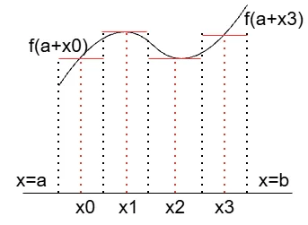
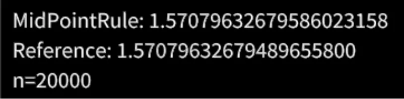

# 中点則  
定積分の値を求める方法で前回は台形を使っての近似を行った.  
単純な方法であれば、矩形による近似[^1]でも問題ない.  

この時矩形ということは台形とは違い、$`S=hw`$みたいな単純な計算で行ける.  
幅に関しては台形則と同様に$`h=\frac{b-a}{n}`$とすると、あとは$`w`$が決まればよい.  
この基準として取るのが中点ということになる.  

  

こんな感じで各$`\frac{h}{n}`$の分割した矩形の中点を$`x_{i}`$として取る.  
そしたら後は$`f(a+x_{i})`$で求めてあげればよい.  

横幅は$`b-a`$というのはすぐわかるので、各矩形の幅は先程求めた通り$`h`$.  
そして、中点というとこれの$`\frac{1}{2}`$の位置なため、$`\frac{h}{2}`$.  
あとは中点の位置としては$`1,3,5, \cdots`$のように奇数の位置となる.  
偶数だと単純に中点ではなく矩形の端となるから、それを飛ばしているわけだ.   
こうするとつまりは  
```math
x_{i} = a + (2i+1) \frac{h}{2}
```
と言える.  
これを使って、
```math
\int_{a}^{b} f(x)dx \approx \sum_{i=0}^{n-1} h f(x_{i})
```
とすれば、分割数$`n`$が大きくなればなるほど正しい値に収束することになる.  

今回の例も$`f(x)=sin^{2}x`$とする、これは積分範囲を$`[0,\pi]`$とすると、答えは$`\frac{\pi}{2}`$となる.  
この値と比較を行えばよい.  

さて、コードに関しては台計則をちょっと変えるだけで済む.  
```c++
auto Calculate = [&]()
    {
        result = 0.0;
        h = (b - a) / n;

        for (int i = 0; i <= n; i++)
        {
            double x = a + (2.0 * i + 1.0) / 2.0 * h;
            result += f(x);
        }

        result = result * h;
    };
```
$`x`$を求めて、それを代入するだけ.  
$`h`$は定数なので、まとめて最後に掛ければOK.  

結果を見てみよう.  

  

うん、ちゃんと近似がされていそう.  
20000回までやったけど収束速度は若干遅いかも？  

[^1]: [中点則（数値積分）](https://qiita.com/omu58n/items/7767898005c6d3e4ca88)