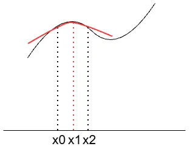
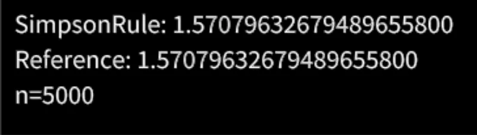

# シンプソン則  
さて、前回は中点則[^1]をやった.  
台形則[^2]では台形で対応する範囲を近似するといったものだった.  
それが、中点則では台形じゃなくて、矩形でもいけるのでは？という推測にて行ったものだった.  

ここまでくると更に高い次数、例えば二次関数とかで近似すればいいんじゃない？という推測ができるはず.  
これがシンプソン則[^3]である.  
今回の計算ではここ[^4][^5]を参考にした.  

シンプソン則は次のような図で、3点を使って近似を行う.  

  

$`x_{0}, x_{1}, x_{2}`$という3点を利用することになる.  
この時、

```math
h = x_{1}-x_{0} = x_{2} - x_{1}
```

という風に、3点における各幅は同じものとして考えるようにしておこう.  
二次関数に関しては$`x_{0}`$の時の値が$`f_{0}`$となるようにすると、

```math
f(x) = a(x-x_{0})^{2} + b(x-x_{0}) + f_{0}
```

となる.  
$`a,b,c`$は計数であるが、$`c=f_{0}`$となっている.  
また、この式に$`x_{0}`$を代入すると$`f_{x_{0}}=f_{0}`$より、確かに成り立っていると思う.  

さて、この式に$`x_{1}`$を代入すると、$`h = x_{1}-x_{0}`$より、

```math
\begin{split}
f_{1} &= a(x_{1}-x_{0})^{2} + b(x_{1}-x_{0}) +f_{0} \\
&= ah^{2}+bh+f_{0}
\end{split}
```
となる.  

次に$`x_{2}`$を代入する.  
$`h = x_{2}-x_{1}`$より$`h+h=(x_{1}-x_{0}) + (x_{2}-x_{1}) = x_{2}-x_{0}`$なので、  

```math
\begin{split}
f_{2} &= a(x_{2}-x_{0})^{2} + b(x_{2}-x_{0}) +f_{0} \\
&= 4ah^{2}+2bh+f_{0}
\end{split}
```

となる.  
$`f_{2} - 2f_{1}`$とすると、

```math
\begin{split}
& f_{2} - 2f_{1} = (4ah^{2}+2bh +f_{0}) - (2ah^{2} + 2bh + 2f_{0}) \\
& f_{2} - 2f_{1} =2ah^{2} - f_{0} \\
& 2ah^{2} = f_{0} - 2f_{1} + f_{2} \\
& a = \frac{f_{0} - 2f_{1} + f_{2}}{2h^{2}}
\end{split}
```

という感じで$`a`$が求まった!!  

次に$`b`$も求めておこう.  
$`f_{2} - 4f_{1}`$とすると、

```math
\begin{split}
& f_{2} - 4f_{1} = (4ah^{2}+2bh +f_{0}) - (4ah^{2} + 4bh + 4f_{0}) \\
& f_{2} - 4f_{1} = -2bh - 3f_{0} \\
& 2bh = -3f_{0} + 4f_{1} - f_{2} \\
& b = \frac{-3f_{0} + 4f_{1} - f_{2}}{2h}
\end{split}
```

これで$`b`$も完了.  

さて、そしたら次に$`[x_{0},x_{2}]`$の区間でこの$`f(x)`$を積分すると、  
```math
\begin{split}
\int_{x_{0}}^{x_{2}} (a(x-x_{0})^{2} + b(x-x_{0}) + f_{0}) dx 
&= [\frac{1}{3}a(x-x_{0})^{3} + \frac{1}{2}b(x-x_{0})^{2} + f_{0}x]^{x_{2}}_{x_{0}} \\
&= \frac{1}{3}a(x_{2}-x_{0})^{3} + \frac{1}{2}b(x_{2}-x_{0})^{2} + f_{0}(x_{2}-x_{0}) \\
&= \frac{1}{3} \frac{f_{0} - 2f_{1} + f_{2}}{2h^{2}} 8h^{3} + \frac{1}{2} \frac{-3f_{0} + 4f_{1} - f_{2}}{2h} 4h^{2} + 2f_{0}h \\
&= \frac{f_{0} - 2f_{1} + f_{2}}{3} 4h + (-3f_{0} + 4f_{1} - f_{2})h + 2f_{0}h \\
&= \frac{4f_{0} - 8f_{1} + 4f_{2}}{3}h + \frac{-3f_{0} + 12f_{1} - 3f_{2}}{3}h \\
&= \frac{f_{0} + 4f_{1} + f_{2}}{3}h
\end{split}
```

という風に$`2h`$区間の計算が求まる!!  
後はこれを全区間に適用してあげれば近似ができる.  

```math
\begin{split}
\int_{x_{a}}^{x_{b}} f(x) dx 
&\approx \sum_{i=0}^{n-1} \frac{f_{2i} + 4f_{2i+1} + f_{2i+2}}{3}h \\
&= \frac{h}{3}((f_{0} + 4f_{1} + f_{2}) + (f_{2}+4f_{3}+f_{4}) + \cdots) \\
&= \frac{h}{3}(f_{0} + 4f_{1} + 2f_{2} + 4f_{3} + 2f_{4} + \cdots) \\
\end{split}
```

こうして計算してみると、偶数は2倍奇数は4倍としたものを足し合わせていけばよいというのが分かる.  
ただし、最初と最後は1倍である点に注意.$`f_{0}`$の場合が分かりやすい.  
これがシンプソン則なわけだ.  

そしたらコードを書いていく.  
やることは簡単でいつもよりも点数が多いので、区間を$`2n`$で割るようにしておく.  
そして、繰り返す回数も2倍にする.  
```c++
auto Calculate = [&]()
    {
        result = 0.0;
        h = (b - a) / (2.0 * n);

        for (int i = 0; i <= 2 * n; i++)
```
あとは奇数偶数と境界を考慮しつつ,、掛ける倍数を決めて足し合わせ.  
最後に$`\frac{h}{3}`$を割れば終わり！  
```c++
        {
            double next = a + i * h;
            double factor = IsOdd(i) ? 2.0 : 4.0;

            if (i == 0 || i == 2 * n)
            {
                factor = 1.0;
            }

            result += factor * f(next);
        }

        result = result * h / 3.0;
    };
```

結果を見てみよう.  

  

うん、そこまで大きくない数字でも精度よく近似が出来ている!!  
これがシンプソン則、結構簡単な推論で精度を上げられるのは面白いところ.  

[^1]: [台形則](./TrapezoidalRule.md)  
[^2]: [中点則](./MidPointRule.md)  
[^3]: [シンプソンの公式](https://w.wiki/3SrT)  
[^4]: [Simpson公式（Simpson's rule，シンプソン法）](https://shintani.fpark.tmu.ac.jp/classes/information_processing_2/integration_2/simpson.html)  
[^5]: [シンプソン則（数値積分）](https://qiita.com/omu58n/items/4025ac6fafbe3d8c1a64)  