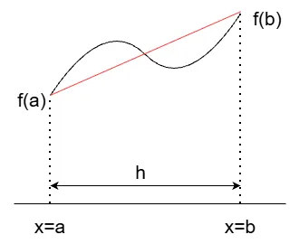
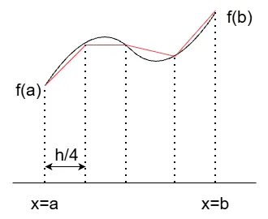
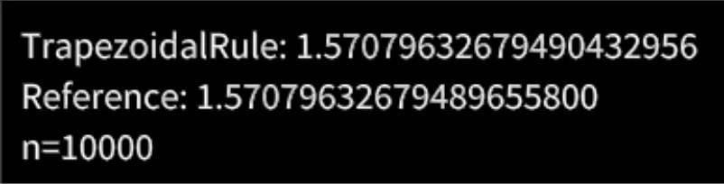

# 台形則  
たまには積分を解くことを考えてみよう.  
ということで、まずは台形則[^1]を試すところから.  
これは非常に単純で、積分の面積計算時に台形で近似していこうという感じ.  
上底を$`a`$,下底を$`b`$,高さを$`h`$とすると、

```math
S = \frac{(a+b)h}{2}
```

とすれば台形の元々の面積を計算できる.  

ここで積分を考えてみよう.  
ある範囲$`[a,b]`$について定積分を行うと,  

```math
\int_{a}^{b} f(x) dx
```

となり、これが導きたい値となる.  
ここで以下のような$`f(x)`$に対して、台形を考えて近似することを考える.  

  

ある地点$`a,b`$の値が分かれば、$`f(x)`$に代入することで$`f(a),f(b)`$が分かる.  
これを上底と下底とする.  
そして、現状の積分区間を$`h=b-a`$とすると,

```math
\int_{a}^{b} f(x) dx \approx \frac{(f(a)+f(b))(b-a)}{2}
```

という近似が可能！  
超大雑把なので、近似精度としてはあまりよくない.  
では、次は4つの区間に均等に分割してみる.  



うん、まだまだ誤差はありそうだけども、さっきよりは良い結果になりそう.  

ここまでくるとある程度予想がついてくるが、まず分割数$`n`$があるとする.  
これが$`n \to \infty`$となっていけば正しい値になるのではないかということ.  
現状の$`n=4`$でも近似精度は上がっているので、確かに大きくすれば成り立ちそうだ.  

ここで、均等に割る場合、各台形の高さは$`\frac{h}{n}=\frac{b-a}{n}`$.  
分割時の各点は$`a_{k}`$と表すとする. この時、近似は以下のようになる.   

```math
\int_{a}^{b} f(x) dx \approx \sum_{k=1}^{n} \frac{(f(a_{k-1})+f(a_{k}))(b-a)}{2n}
```

ここで、和記号を分解していくと$`a_{0},a_{n}`$は式的に1度しか出てこないことも考慮すると,  

```math
\begin{split}
\sum_{k=1}^{n} \frac{(f(a_{k-1})+f(a_{k}))(b-a)}{2n}
&= \frac{b-a}{2n}(f(a_{0}) + f(a_{n}) +2 f(a_{1}) + 2f(a_{2}) + \cdots + 2f(a_{n-1})) \\
&= \frac{b-a}{n}(\frac{f(a_{0})+ f(a_{n})}{2} + \sum_{k=1}^{n-1}f(a_{k}))
\end{split}
```

を計算できればいいというわけだ！  
ただし、$`a_{k}`$は$`a_{k}= a + (b-a)\frac{k}{n}`$で計算可能.  
$`k=0`$なら$`a`$だし、$`k=n`$なら$`b`$となる.  
$`k \in [1,n-1]`$の範囲ならその間の均等な点を表すので、確かにこの計算で大丈夫そうだ.  

さて、今回は$`\sin^{2}x`$を解くことを考える.  
この時$`a=0, b= \pi`$とすると、面積は$`S=\frac{\pi}{2}`$となる.  
これを台形測で計算してみよう.  

まずは関数、これは簡単.  
```c++
auto f = [](double x)
{
    return Sin(x) * Sin(x);
};
```
次に計算、まずは高さを求めておく.  
```c++
auto Calculate = [&]()
    {
        result = 0.0;
        h = (b - a) / n;
```
そしたら$`a_{k}= a + (b-a)\frac{k}{n}`$を計算する.  
今$`k=i`$なので、そのまま代入.  
$`\frac{b-a}{n} = h`$も使って、後は$`f(a_{0}),f(a_{n})`$の時のみ$`2`$で割るのを忘れずに.  

```c++
        for (int i = 0; i <= n; i++)
        {
            if (i == 0 || i == n)
            {
                result += f(a + i * h) / 2.0;
            }
            else
            {
                result += f(a + i * h);
            }
        }
```

最後に全体を$`h`$で割れば終了.  
```c++
        result = result * h;
    };
```

結果を見てみよう.  



うん、$`n=100`$の場合でもある程度の精度で計算出来てる.  
試しに$`n=10000`$とかにしてみると、

それでもまだ誤差は出ている...  
この後どれだけ大きくしても値が収束しないが、これは丸め誤差の影響.  
どうしても値が増えちゃうと各分割台形で誤差が出ちゃうのが困ったちゃん.  

とはいえある程度の精度で良ければこれでも全く問題ない.  
といったところで今回はここまで.  

[^1]: [台形公式](https://w.wiki/4SPT)  