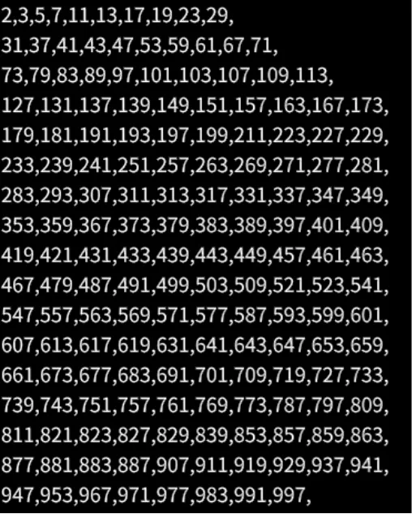

# エラトステネスの篩  
素数判定の王、個人的に一番有名なのはエラトステネスの篩[^1]な気はしています.  
エラトステネスの篩はやることは簡単で、素数の倍数を片っ端から潰していくということをするだけ.  

例えば1から30までのマスを用意する.  

```
1:t  2:t  3:t  4:t  5:t  6:t  7:t
8:t  9:t  10:t 11:t 12:t 13:t 14:t 
15:t 16:t 17:t 18:t 19:t 20:t 21:t
22:t 23:t 24:t 25:t 26:t 27:t 28:t
29:t 30:t
```

マスにはtrueかfalseの判定結果が入るようになっている.  
trueは`t`,falseは`f`で表すことにする.  
この時`t`なら素数,`f`なら素数じゃないということになる.  

エラトステネスはまず一番最初の素数を見つける.  
これは2だ、1は素数じゃない.1を含めたらプッチ神父も怒ってしまう.  
そして、2の倍数は2で割れるため素数じゃない.  
そのため、2の倍数は`f`にして振り落とす！  

```
1:t  2:t  3:t  4:f  5:t  6:f  7:t
8:f  9:t  10:f 11:t 12:f 13:t 14:f 
15:t 16:f 17:t 18:f 19:t 20:f 21:t
22:f 23:t 24:f 25:t 26:f 27:t 28:f
29:t 30:f
```

この段階で4,6,8,10,12,14,16,18,20,22,24,26,28,30が脱落！  
14個なのでほぼ半分が素数でないことになる.  
1を除けば残っている素数は15個だ.  
次に小さい素数は3、そのため3の倍数を次は落とす.  

```
1:t  2:t  3:t  4:f  5:t  6:f  7:t
8:f  9:f  10:f 11:t 12:f 13:t 14:f 
15:f 16:f 17:t 18:f 19:t 20:f 21:f
22:f 23:t 24:f 25:t 26:f 27:f 28:f
29:t 30:f
```

9,15,21,27が脱落！  
残っている素数は11個.  
次に小さい素数は5、そのため5の倍数を次は落とす.  

```
1:t  2:t  3:t  4:f  5:t  6:f  7:t
8:f  9:f  10:f 11:t 12:f 13:t 14:f 
15:f 16:f 17:t 18:f 19:t 20:f 21:f
22:f 23:t 24:f 25:f 26:f 27:f 28:f
29:t 30:f
```

25が脱落！
残っている素数は10個.  
次に小さい素数は7、そのため7の倍数を次は落とす...がこれはない.  
次に小さい素数は11、そのため11の倍数を次は落とす...がこれはない.  
次に小さい素数は13、そのため13の倍数を次は落とす...がこれはない.
次に小さい素数は17、これ以降は2倍すると30を超えちゃうので落とせない.  
そのため省略をする.  

```
1:t  2:t  3:t  4:f  5:t  6:f  7:t
8:f  9:f  10:f 11:t 12:f 13:t 14:f 
15:f 16:f 17:t 18:f 19:t 20:f 21:f
22:f 23:t 24:f 25:f 26:f 27:f 28:f
29:t 30:f
```

こんな感じで小さい方の素数から合成数となる数を片っ端から落とすのが篩っぽい動き.  
これをコードで書くと以下のような感じ.  

```c++
for (int i = 2; i < N; i++)
{
    if (container[i]) // 素数のみ篩をかける
    {
        // 倍数部分のみ回ればOK
        for (int j = i * 2; j < N; j+=i)
        {
            container[j] = false;
        }
    }
}
```
小さい方から素数を探して、見つかったら倍数を振り落とす.これだけだ！  

さて、これだとちょっと無駄が多いので最適化してみよう.  
まず倍数の部分.  
```c++
int j = i * 2;
```
こんな感じで二倍にしているが、2ってすでに弾いてるので無駄.  
この後$`i`$ずつ足していくけど、この中にも既に確定した素数があると無駄な計算となる.  
つまり、自分の数字より下の倍数はすべて弾いても問題ないので、以下のようにスキップが可能.  
```c++
int j = i * i;
```
これでちょっと軽くなった！  

次に見るのはループ回数.  
```c++
for (int i = 2; i < N; i++)
```
頭から$`N`$まで見ているけど、そもそも考えてほしい.  
エラトステネスの篩は$`i*i`$より下は先程述べた通り、小さい素数が含まれてるorすでに弾いてるので見る必要がない.  
そして、エラトステネスの篩で確認したいのは$`N`$までの値.  
そのため$`i=\sqrt{N}`$より大きい値は$`i*i`$の計算で$`N`$を超えちゃうのでやる必要がない.  
よって、以下のループで問題ない.  
```c++
	for (int i = 2; i <= Sqrt(N); i++)
```
ただし$`Sqrt`$が負荷的に気になるなら$`i*i`$で判定してもよい.  

```c++
	for (int i = 2; i*i <= N; i++)
```

ここまでをまとめた結果が以下.  

```c++
for (int i = 2; i*i <= N; i++)
{
    if (container[i]) // 素数のみ篩をかける
    {
        // 倍数部分のみ回ればOK
        for (int j = i * i; j < N; j+=i)
        {
            container[j] = false;
        }
    }
}
```

うん、単純だけどこれだけでも軽くなっている！  
さて、最後に1000までの素数を列挙してみよう.  

  

いい感じ、168個なのでちゃんと素数判定が出来ていそうですね.  

[^1]: [エラトステネスの篩](https://w.wiki/3N9J)  